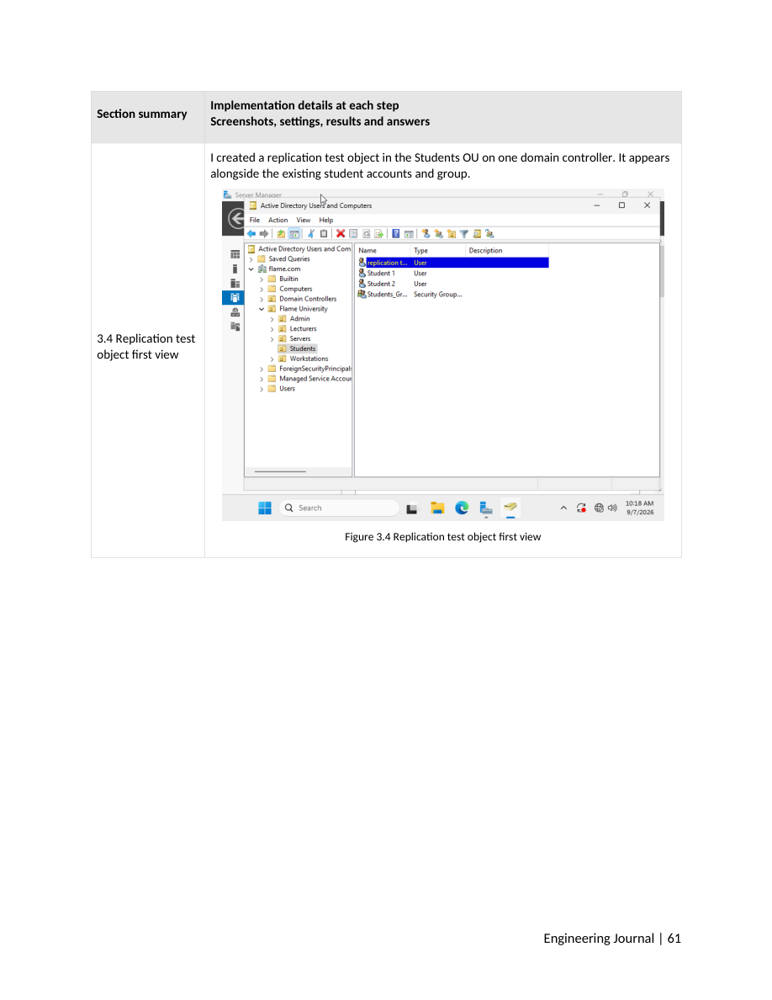
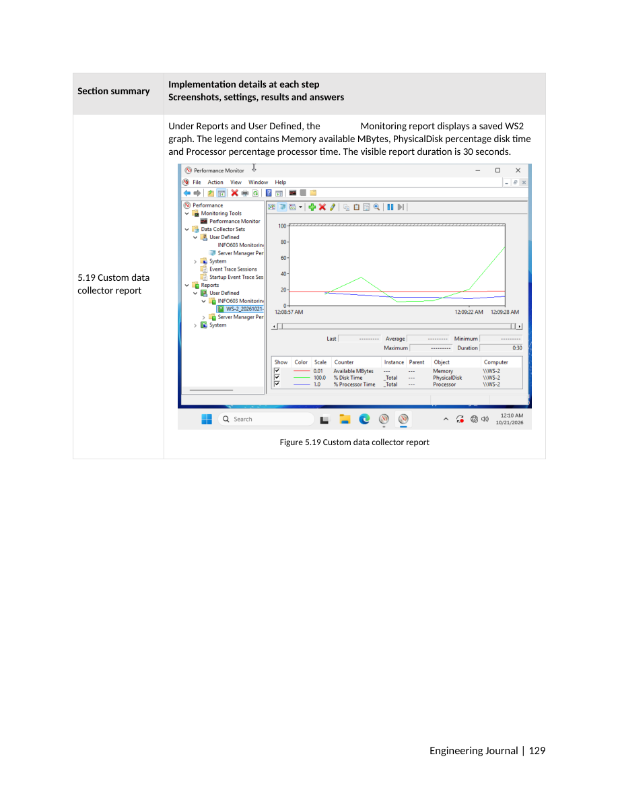
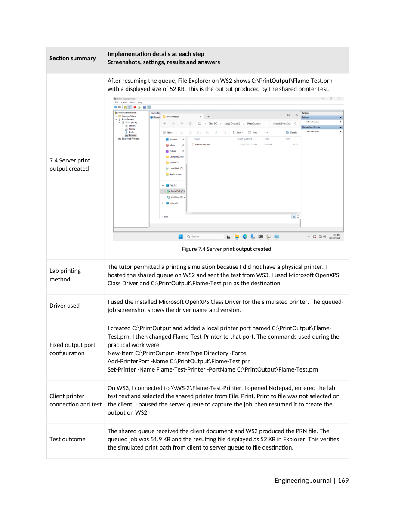
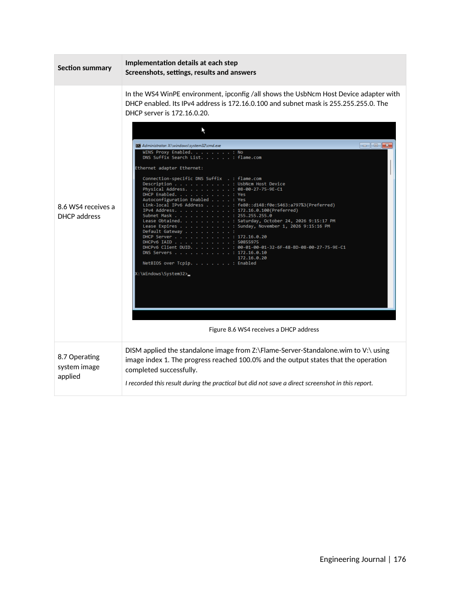

# Windows Server 2025 Administration Lab

A practical Windows Server infrastructure lab documenting installation, Active Directory, network services, file services, remote access, monitoring, Group Policy, printing and operating-system deployment.

**Author:** Tirth Patel  
**Environment:** Windows Server 2025 ARM64 virtual machines, Oracle VirtualBox and a Mac host.  
**Lab scenario:** Flame University, a fictional organisation used for the infrastructure exercises.  
**Evidence period:** Practical work recorded up to 10 November 2026.

## Read the project portfolio

[Download the 184-page implementation portfolio](docs/Windows_Server_Administration_Portfolio.pdf)

The portfolio contains screenshots, configuration explanations, commands, troubleshooting notes and final outcomes. Student identifiers and course/college identifiers have been removed from the publication copy. Original page numbers are retained for locating evidence.

This repository is an evidence and documentation portfolio. VM disks, installation media, operating-system images, domain credentials and executable deployment scripts are not included.

## Lab environment

| Device | Recorded purpose | Main documented address |
| --- | --- | --- |
| WS1 / WS-1 | Primary server, domain controller, DNS and deployment-share services | `172.16.0.10/16` |
| WS2 / WS-2 | Additional domain controller, DNS, DHCP and supporting server roles | `172.16.0.20/16` |
| WS3 / WS-3 | Client-side domain, policy and access testing | `172.16.0.30/16` |
| WS4 | Target for stock-image deployment and the later capture attempt | DHCP; `172.16.0.100` recorded during deployment |

The lab uses the `flame.com` Active Directory domain. WS3 runs a Windows Server evaluation installation for client-side tests. These addresses describe recorded lab stages; DHCP and deployment work introduced later changes. The portfolio records those differences rather than presenting one unchanged configuration throughout.

## Implementation areas

| Area | Work recorded | Evidence limits |
| --- | --- | --- |
| Initial configuration | VM creation, names, static addressing, system settings, connectivity checks and firewall configuration | ARM64 environment differs from the older reference platform |
| Network services | AD DS/DNS installation, domain joins, DNS checks, IIS site checks, WINS registrations and later DHCP configuration | Child-domain stage not documented; some settings differ from the reference design |
| Active Directory | Two domain controllers, replication checks, organisational units, groups, accounts, logon hours, functional levels and Global Catalog settings | Windows Admin Center installation and two-domain logon test incomplete |
| File services | DFS replication, NFS permissions, hard quotas, file screening, deduplication and a backup run | Remaining permission, backup-selection, quota and enforcement checks documented |
| Remote access and monitoring | Managers-group remote access, denied access for an unauthorised account, monitoring tools and CPU alert generation | Connection Broker, RemoteApp and exact seven-day reliability averages incomplete |
| Group Policy and security | Department policies, Accounts restrictions, account lockout, PuTTY deployment and selected firewall tests | WSUS unavailable in this installation; complete effective service-rule inventory not exported |
| Shared printing | Client submission to a shared server queue and a server-created PRN output file | Simulated printing; no physical printer used |
| Windows deployment | WinPE boot, DHCP, SMB image access, DISM application, UEFI boot files and successful stock-image boot | Firmware PXE and custom operating-system capture/deployment not completed |

## Active Directory and network services

- Established `flame.com`, joined the additional server and test client, and later documented WS1 and WS2 as domain controllers.
- Created organisational units, departmental groups and representative accounts for the fictional organisation.
- Checked directory replication, Global Catalog settings and Windows Server 2025 functional levels.
- Tested domain identity, internal name resolution and connectivity.
- Documented DNS, WINS, IIS and DHCP work across the lab stages.



## File services and protection

- Tested DFS replication between server folders.
- Configured NFS share permissions, File Server Resource Manager quotas and file screening.
- Enabled deduplication and recorded a completed backup run.
- Recorded remaining checks rather than treating configuration alone as proof of enforcement.

The final report notes that Accounts subfolder permissions still need verification, LinuxFiles was absent from the recorded backup selection, some quotas were missing or deferred, and a direct NFS client mount test and separate quota/file-screen enforcement tests were not captured.

## Remote access, monitoring and Group Policy

- Tested permitted remote access for a Managers-group account and refusal for an unauthorised account.
- Used monitoring and reliability tools and generated a CPU alert.
- Applied departmental policies, verified Accounts restrictions, configured account lockout and tested application deployment.
- Successfully deployed and opened a native ARM64 PuTTY MSI through Group Policy after an earlier wrapped 7-Zip approach did not establish automatic installation.
- Tested LDAP on TCP 389, SMB on TCP 445 and a controlled listener on TCP 65000, including an allow/block comparison while ping remained available.



## Printing simulation

A test client submitted a document to a shared queue on WS2, and the server produced a PRN output file. This demonstrates the recorded shared-queue workflow. It does not establish physical printer operation, print quality or network-printer protocol behaviour.



## ARM64 deployment and troubleshooting

The target VM did not expose a usable firmware PXE path in the inspected configuration. An alternative stock-image deployment used:

1. A prepared ARM64 WinPE ISO.
2. Network-adapter investigation and DHCP verification.
3. SMB access to the deployment share.
4. A standalone WIM exported from the source image.
5. DISM image application to the target Windows partition.
6. BCDBoot to create UEFI boot files.
7. A successful boot of WS4 from its virtual disk.

The report records a temporary driver-signature-enforcement workaround for one WinPE boot during the successful stock deployment. It is lab troubleshooting evidence, not a recommendation to disable signature enforcement on managed servers.

A later custom-image capture attempt remained blocked by the WinPE network driver's Code 52 / `0xC0000428` signature error. Creating a capture boot environment and adding it to WDS did not constitute a completed capture of the customised operating system.



## Verification commands recorded

The portfolio includes commands used for specific checks, such as:

```powershell
whoami
gpupdate /target:user /force
gpupdate /force
repadmin /replsummary
Test-NetConnection 172.16.0.10 -Port 389
Test-NetConnection 172.16.0.10 -Port 445
Test-NetConnection 172.16.0.10 -Port 65000
Get-WindowsFeature *UpdateServices*
```

These are evidence references, not a complete installation script. Results depend on the device, account, server role and lab stage. The report's service-port table explains dependencies; it is not an exported inventory proving every firewall rule exists.

## Remaining work

- Complete or document the child-domain and two-domain logon stages.
- Resolve the Windows Admin Center compatibility issue.
- Verify the outstanding file permissions, backup inclusions, quotas and enforcement tests.
- Complete Connection Broker and RemoteApp deployment and collect exact reliability values.
- Revisit update management in a compatible environment and export effective firewall rules.
- Retest supported network boot and complete custom-image capture, upload and deployment.

## Repository contents

```text
Windows-Server-2025-Administration-Lab/
├── README.md
├── docs/
│   └── Windows_Server_Administration_Portfolio.pdf
└── assets/
    └── evidence-page-*.png
```

No live infrastructure was accessed during repository preparation. The documented outcomes are historical lab evidence and recorded practical notes, not a fresh execution of the environment.

## Skills represented

Windows Server administration, Active Directory Domain Services, DNS, DHCP, WINS, IIS, directory replication, organisational units, groups, DFS, NFS, FSRM, deduplication, backup, remote access, performance monitoring, Group Policy, application deployment, firewall testing, print services, WDS, WinPE, DISM, UEFI boot configuration, PowerShell, virtualisation and technical troubleshooting.
